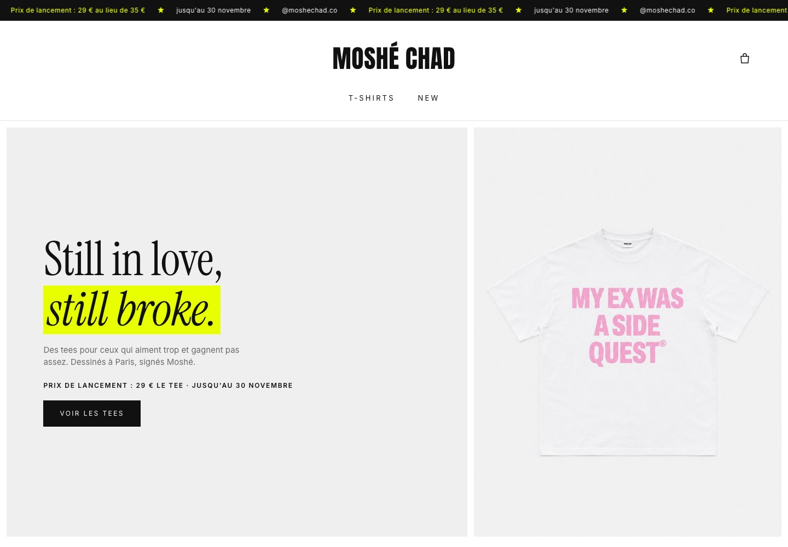
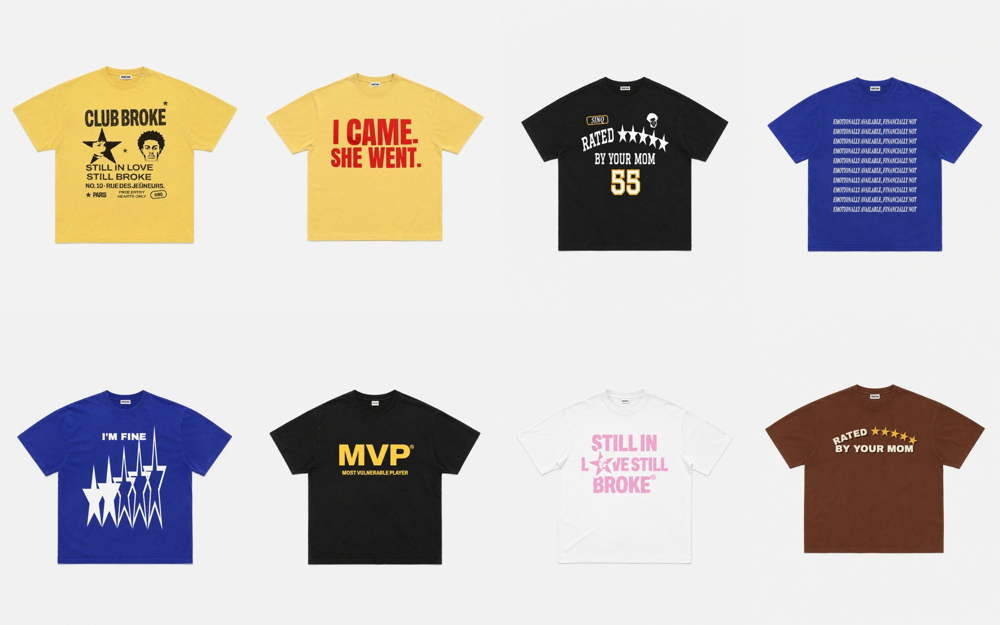
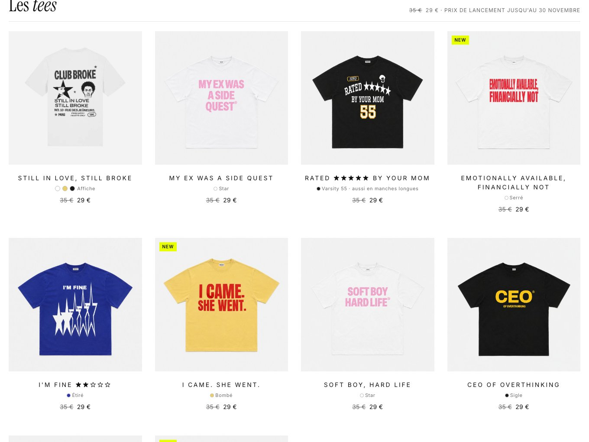

# Moshé Chad

**A t-shirt brand for people who love too much and earn too little.** Short sentences that make you think "that's me" or "that's my friend" in one second: *Still in love, still broke*, *Rated ★★★★★ by your mom*, *My ex was a side quest*, *CEO of overthinking*.

I run the whole project: the brand, the designs, the online shop, the product photos, the ads and the social media.

> This repository is a showcase. The shop's source code is private.

## The brand

- **One rule for every sentence:** a known format, a bold punchline, a situation everyone has lived. The angle is the loser in love: broke, ghosted, too sensitive, but always for a laugh.
- **11 sentences, 34 tees**, each sentence in several styles (poster, studio, star, logo, glitter, stretched, varsity), designed in Paris and readable in France and abroad.
- **Product photos made with AI**: realistic flat lays for the whole catalogue, then AI models wearing the tees for the hover view, all in one consistent studio look.

## The shop

- **Print on demand**: every order is paid with Stripe and sent automatically to Printful, which prints and ships the tee. No stock, no warehouse.
- **Checkout**: Stripe Checkout with Apple Pay, branded receipts, a Stripe webhook that creates the Printful order with the right size, colour and print position.
- **Print files**: a Python pipeline exports every design at 4500 × 5400 px (300 dpi), places it on the tee and adds the "Fait par Moshé" label to the product photos.
- **Referral program**: each customer can create a personal link and follow how many people they brought, with a private dashboard to check every referral by hand.
- **Ads**: Meta Conversions API, only after cookie consent, and about fifty short video ads cut and sound-designed for Instagram and TikTok.

## Under the hood

- Static HTML, CSS and vanilla JavaScript, no framework
- **Vercel** serverless functions for checkout, webhook, referrals and tracking
- **Stripe** (Checkout, webhooks, receipts) and the **Printful API**
- **Vercel Blob** for the referral data
- **Python** (Pillow) for print files, labels and image batches

Built with Claude Code as a pair programmer: I decide the brand, the sentences, the look and the prices, and we build it together.

[moshechad.com](https://moshechad.com) · Instagram [@moshechad.co](https://instagram.com/moshechad.co)

© 2026 Moshé Chad. All rights reserved.
